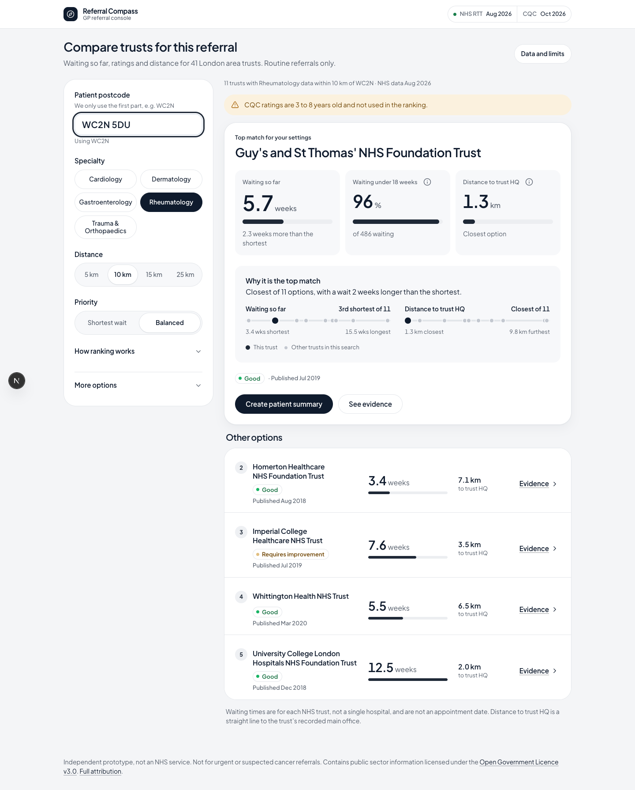

# Referral Compass

**Independent prototype, not an NHS service.** Not for urgent or suspected cancer referrals.

Live: **https://referral-compass.vercel.app**



## What it does

Referral Compass helps a GP in England compare NHS trusts for a routine outpatient referral, during a 10 minute appointment. The GP enters the patient's postcode, picks a specialty and a distance (5, 10, 15 or 25 km), and gets the top match for those settings plus up to four other options. Each one shows how long people on its list have waited so far, how many are waiting under 18 weeks, its CQC rating and its distance to the trust HQ. One tap opens the evidence behind every number, and the GP can print a plain language summary for the patient. It covers 41 NHS trusts in and around London and five specialties: Cardiology, Dermatology, Gastroenterology, Rheumatology, and Trauma and Orthopaedics.

## How the ranking works

Each trust in range gets a score from 0 to 1 for waiting time and for distance, compared with the other trusts in the same search (the best gets 1, the worst gets 0). The overall score is a weighted sum:

| Priority | Wait | Distance | CQC rating |
|---|---|---|---|
| Balanced (default) | 0.55 | 0.45 | not used |
| Shortest wait | 0.75 | 0.25 | not used |

**Why CQC is optional.** Every CQC overall rating in this data is 3 to 8 years old, while the waiting times are from August 2026. Letting a rating from 2018 move a trust above one with a shorter wait today would give old information the same weight as current data, without the GP being able to see it. So ratings are always shown next to each trust, but they only change the order if the GP ticks "Include CQC rating in the ranking". That uses wait 0.4, quality 0.3 and distance 0.3 (or 0.6, 0.2 and 0.2 for Shortest wait).

If the top two scores are within 0.03 of each other, the result says it is a close call. The Evidence panel shows every score with its formula and source.

## Data sources

| Data | Source | Date |
|---|---|---|
| Waiting times | NHS England Referral to Treatment (RTT) full CSV extract, people still waiting | August 2026, published October 2026 |
| Quality ratings | Care Quality Commission, Latest ratings file | File dated 1 October 2026, downloaded 3 November 2026 |
| Trust addresses | NHS Organisation Data Service API | Looked up November 2026 |
| Locations | postcodes.io | Trust postcodes November 2026; the patient's area is looked up live |

Contains public sector information licensed under the [Open Government Licence v3.0](https://www.nationalarchives.gov.uk/doc/open-government-licence/version/3/). Full attribution is on the [Data and limits](https://referral-compass.vercel.app/data) page.

## Limits

- **Waiting so far is not a booking date.** The main number is how long half of the people currently on the list have waited so far. It does not predict when a new patient will be seen.
- **Hospital trusts, not GP surgeries or single hospitals.** NHS England publishes waiting times per trust. A trust can run several hospitals with different waits.
- **CQC ratings are 3 to 8 years old** and cover the whole trust, not the specialty.
- **Distance is a straight line** from the centre of the patient's postcode area to the trust's registered address. The clinic may be at another site.
- **London area only:** 41 trusts in and around London. Specialist and community trusts are hidden unless the GP turns them on, and trust and specialty pairs with fewer than 50 people waiting are not ranked.
- **Privacy:** only the first part of the postcode (for example WC2N) is sent to postcodes.io. Nothing is stored, and the summary link carries no postcode.

## Run it locally

Needs Node.js 20 or later.

```bash
npm install
```

```bash
npm run dev
```

Then open http://localhost:3000. The built data in `data/` is committed, so no downloads are needed to run the app.

To rebuild the data from source, put the RTT CSV at `data/raw/rtt.csv` and the CQC ratings file at `data/raw/cqc/latest_ratings.ods`, then:

```bash
npm run data:cqc
```

```bash
npm run data
```

## Run the checks

Ranking check. It recomputes the top 5 for Rheumatology near WC2N by hand and compares it with the app, and checks the weights add up to 1:

```bash
node checks/verify-ranking.mjs
```

Layout check. With the dev server running, it loads the console, the Evidence panel and the summary at 320, 390, 768, 1024 and 1440 pixels wide, and fails if anything overflows. It uses the Google Chrome installed on your machine:

```bash
node checks/layout-check.mjs http://localhost:3000
```

The build log in [BUILD_LOG.md](BUILD_LOG.md) records each decision, mistake caught and check result.
